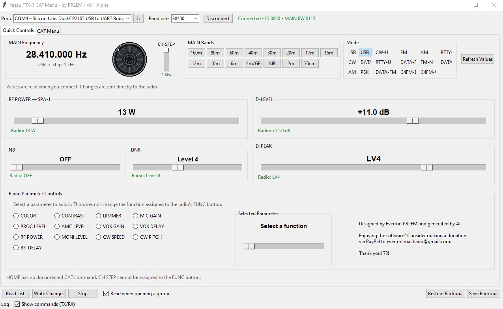

# Yaesu FTX-1 CAT Menu — by PR2EM


> A Python desktop application for reading and controlling the Yaesu FTX-1 transceiver through its serial CAT interface. It brings together quick operating controls, band selection, and CAT menu parameter management.

> **Version:** 0.3 Beta. This project is under development. Use care when writing settings to your radio.

[Versão em Português](#versão-em-português)

## 📷 Screenshot



## 🚀 Features

- **CAT connection:** automatically detects and selects the Silicon Labs CP2105 `Enhanced COM Port` when available, and remembers the last port and baud rate you used.
- **Radio identification:** reads the radio ID and the firmware version of every CPU (MAIN, DISPLAY, SDR, DSP, SPA-1, FC-80) after connecting.
- **Live display (Auto Information):** the radio reports frequency, mode and status changes by itself (`AI1;`), so the display follows the physical dial instantly. Falls back to periodic reads if the radio does not accept it (LIVE/POLL indicator).
- **Status bar and meters:** RX/TX, HI-SWR, BUSY, TUNE and SCAN indicators, S-meter while receiving and PO/SWR/ALC while transmitting (raw 0-255 scale; calibration to S-units and watts is planned).
- **MAIN tuning:** displays the current frequency and mode, and the memory channel when the radio is in memory mode.
- **Direct frequency entry:** accepts abbreviated numeric input and applies separators automatically; for example, `1448` becomes `144.800.000 Hz` and `27555` becomes `27.555.000 Hz`.
- **On-screen dial:** changes frequency with the mouse wheel.
- **Band selection:** buttons request the FTX-1 CAT band selection and use the radio's internal Band Stack rather than sending a fixed frequency. Since the CAT Band Select list has no 11 m entry, the **11m** button directly tunes to 27.555 MHz (DX calling frequency) while keeping the current mode.
- **Mode selection:** buttons select available MAIN operating modes.
- **CH-STEP:** a vertical slider adapts to the current mode and supports dragging, clicking the scale, and mouse wheel adjustment.
- **Quick controls:** sliders adjust RF POWER, D-LEVEL, D-PEAK, NB, and DNR and send changes while you adjust them. RF POWER follows the hardware reported by the radio: 5-10 W on the FTX-1 field head, 5-100 W with the SPA-1.
- **FUNC parameters:** select a parameter to adjust locally without changing the assignment of the radio's physical FUNC button.
- **CAT menu:** search and read menu items; supported items can be written individually or in batches. Edited values are highlighted until they are written.
- **Backup and restore:** saves read settings to JSON and compares a backup with the current state before restoring compatible values.
- **Memories:** reads a range of memory channels with their tags, lets you edit frequency, mode, tag, shift and squelch type, writes changes back after showing a diff, recalls a channel, stores the current VFO into a channel, and exports/imports CSV.
- **Communication log:** reports operation progress, can show CAT commands sent and received, and can be copied to the clipboard. A log file is also kept on disk.
- **Simulator mode:** `--simulate` runs the whole application against a built-in fake radio — no FTX-1 or serial port needed. Useful for trying the app and for development.
- **Rejected commands are reported:** when the radio answers `?;` the app says so immediately instead of waiting for a timeout.

## 🛠️ Technologies and resources

### Language

- Python 3.8 or newer.

### Libraries and frameworks

- **Tkinter / ttk:** graphical interface.
- **pyserial 3.5:** serial port discovery and CAT communication.
- **Python standard library:** including `threading`, `queue`, `json`, `logging`, `pathlib`, and `tkinter`.
- **pytest / ruff (development only):** automated tests and linting.

### AI development tools

- **OpenAI Codex** and **Claude Code:** used as development and maintenance assistants. See [AGENTS.md](AGENTS.md) for the project rules they follow. The application does not call AI APIs at runtime and does not require an API key.

## 📦 Requirements and installation

### Requirements

- Windows 10/11 (the instructions below are for Windows; Linux and macOS also work).
- Python 3.8+ installed with Tcl/Tk.
- Git.
- Yaesu FTX-1 connected to the computer by USB using the **Enhanced COM Port (CAT-1)**.
- The radio's CAT-1 baud rate must match the application setting; the factory default is 38400 bps.

### Clone and install

Open PowerShell in the folder where you want to store the project:

```powershell
git clone https://github.com/evertonma/FTX-1CAT_PR2EM.git
cd FTX-1CAT_PR2EM
py -m venv .venv
.\.venv\Scripts\python.exe -m pip install -r requirements.txt
```

Run the application:

```powershell
.\.venv\Scripts\python.exe -m ftx1cat
```

Try it without a radio:

```powershell
.\.venv\Scripts\python.exe -m ftx1cat --simulate
```

Other options: `--port COM4`, `--baud 38400`, `--debug` (writes CAT traffic to the log file), `--version`. The old entry point `python ftx1_cat_menu.py` still works.

These commands do not require activating the virtual environment with `Activate.ps1`, avoiding PowerShell script execution policy issues.

### Settings and log file

No `.env` file or environment variables are required. The application stores its settings (last port, baud rate, window size, options) and a rotating log file in `%APPDATA%\FTX1CAT` on Windows (`~/.config/ftx1cat` on Linux/macOS).

## 💻 How to use

1. Connect and power on the FTX-1.
2. Start the application. If detected, the CP2105 Enhanced COM Port is selected automatically.
3. Check the CAT-1 baud rate and click **Connect**. Wait for radio identification and the initial control readings.
4. In **Quick Controls**, use the on-screen dial or click the MAIN frequency display to enter a frequency. The display also follows changes made with the radio's physical dial.
5. Click a band button to request that band from the radio. With **BAND STACK** enabled on the FTX-1, the radio recalls the frequency and mode stored in its Band Stack.
6. Adjust the sliders to send RF POWER, D-LEVEL, D-PEAK, NB, DNR, or CH-STEP changes.
7. To read or change other settings, open **CAT Menu**, choose a group, and use **Read**, **Write**, or the batch read/write commands. Changed values are marked "Changed (not written)" until you write them.
8. Use **Save Backup…** before larger changes. Restore compares values first and asks for confirmation before writing.
9. **Stop** (top right) interrupts a long read, write, backup or restore.

### Frequency entry examples

Type digits without separators; punctuation is applied automatically.

| Input | Frequency sent |
| --- | --- |
| `1448` | `144.800.000 Hz` |
| `27555` | `27.555.000 Hz` |

### Troubleshooting

- If the port does not appear, check the USB connection and refresh the port list.
- The application looks for `CP2105` and `Enhanced` in the port description. If the driver uses a different name, select the CAT-1 port manually.
- If the radio does not respond, check that **Enhanced COM Port (CAT-1)** is selected, the baud rate matches `CAT-1 RATE`, and no other application has opened the port.
- If Tkinter fails to start, install or repair Python with Tcl/Tk included.
- Band selection depends on **BAND STACK** being enabled on the radio.
- A "Rejected (?)" status means the radio answered `?;`: the item does not exist on this firmware or the value is invalid.
- When reporting a problem, attach the log file from `%APPDATA%\FTX1CAT\ftx1cat.log` (run with `--debug` to include CAT traffic).

## 🧭 Simplified workflow

```text
Start application
  → locate CAT-1 port
  → open serial connection and identify radio
  → read frequency, mode, and quick controls
  → send CAT commands as controls change
  → query radio again and refresh the interface
```

All serial traffic runs on a single background thread (one command at a time), so the interface stays responsive and commands never overlap. Slider movements are coalesced: only the latest value is sent.

## 🗂️ Project structure

```text
FTX-1CAT_PR2EM/
├── ftx1cat/                 # Application package (python -m ftx1cat)
│   ├── cat/                 # CAT protocol — no Tkinter here
│   │   ├── menu.py          #   EX menu item table (data + validation)
│   │   ├── commands.py      #   FA, MD, BS, PC, SS... command builders and tables
│   │   ├── transport.py     #   Radio: serial communication
│   │   └── simulator.py     #   FakeFTX1: fake radio for tests and --simulate
│   └── ui/                  # Tkinter interface
│       ├── app.py           #   main window, connection, log, job runner
│       ├── quick_controls.py#   Quick Controls tab
│       ├── menu_page.py     #   CAT Menu tab, backup/restore
│       ├── memory_page.py   #   Memories tab, CSV import/export
│       ├── status_bar.py    #   RX/TX indicators and meters
│       ├── worker.py        #   background serial job queue
│       ├── settings.py      #   persistent settings
│       └── widgets.py       #   scroll frame, dial, slider helpers
├── tests/                   # pytest suite (runs without a radio)
├── docs/                    # screenshot, evaluation, CAT roadmap and the manuals as Markdown
├── ftx1_cat_menu.py         # Compatibility launcher (v0.1 entry point)
├── AGENTS.md                # Rules for AI coding assistants and contributors
├── pyproject.toml           # Package metadata, pytest and ruff configuration
├── requirements.txt         # Runtime dependency
├── requirements-dev.txt     # Development dependencies (pytest, ruff)
├── CHANGELOG.md             # Release notes
├── LICENSE                  # PolyForm Noncommercial License 1.0.0
└── README.md                # This documentation
```

## 🧪 Development

```powershell
.\.venv\Scripts\python.exe -m pip install -r requirements-dev.txt
.\.venv\Scripts\python.exe -m ruff check ftx1cat tests   # lint
.\.venv\Scripts\python.exe -m pytest                      # tests (uses the simulator)
```

On Linux the GUI tests need a display: `xvfb-run -a python -m pytest`. GitHub Actions runs lint and tests on Windows and Linux for every push.

## 🤝 Contributing

1. Fork the repository.
2. Create a branch for your change: `git switch -c feature/my-improvement`.
3. Read [AGENTS.md](AGENTS.md): it explains where each kind of code lives and the rules for CAT commands and threading.
4. For new CAT commands, include the corresponding FTX-1 manual reference, add the command to the simulator, and write a test.
5. Run `ruff check` and `pytest` before opening a pull request. When possible, also test with a radio.
6. Include a behavior summary, reproduction steps, and screenshots for interface changes, and add a line to `CHANGELOG.md`.

Do not include personal backups, radio configuration files, virtual environments, or documents that cannot be redistributed. Contributions are subject to the project's noncommercial license unless the copyright holder agrees otherwise in writing.

## 📄 License

This software is licensed under the **PolyForm Noncommercial License 1.0.0**. It permits use, modification, and redistribution for noncommercial purposes. Commercial use requires separate permission from the copyright holder. See [LICENSE](LICENSE) and the [official license text](https://polyformproject.org/licenses/noncommercial/1.0.0/). This is a source-available license, not an OSI-approved open-source license.

## 👤 Credits

Developed by **Everton Machado — PR2EM**, with assistance from **OpenAI Codex** and **Claude Code**. The v0.2 refactor included contributions from **[@machadouglas](https://github.com/machadouglas)**.

---

# Versão em Português

## Yaesu FTX-1 CAT Menu — by PR2EM

> Aplicativo desktop em Python para consultar e controlar o transceptor Yaesu FTX-1 pela interface serial CAT. Reúne controles rápidos de operação, seleção de banda e gerenciamento dos parâmetros do menu CAT.

> **Versão:** 0.3 Beta. O projeto está em desenvolvimento. Tenha cuidado ao gravar configurações no rádio.

## 📷 Captura de tela


## 🚀 Funcionalidades

- **Conexão CAT:** detecta e seleciona automaticamente a porta `Enhanced COM Port` do adaptador Silicon Labs CP2105 quando disponível, e lembra a última porta e taxa usadas.
- **Identificação do rádio:** lê o ID do rádio e a versão de firmware de cada CPU (MAIN, DISPLAY, SDR, DSP, SPA-1, FC-80) após a conexão.
- **Display ao vivo (Auto Information):** o rádio informa sozinho mudanças de frequência, modo e estado (`AI1;`), e o display acompanha o dial físico na hora. Se o rádio não aceitar, volta à leitura periódica (indicador LIVE/POLL).
- **Faixa de status e medidores:** indicadores RX/TX, HI-SWR, BUSY, TUNE e SCAN, S-meter em recepção e PO/SWR/ALC em transmissão (escala bruta 0-255; calibração para S-units e watts está planejada).
- **Sintonia MAIN:** exibe a frequência e o modo atuais, e o canal de memória quando o rádio está em modo memória.
- **Entrada direta de frequência:** aceita números abreviados e aplica separadores automaticamente; por exemplo, `1448` se torna `144.800.000 Hz` e `27555` se torna `27.555.000 Hz`.
- **Dial na interface:** altera a frequência com o scroll do mouse.
- **Seleção de banda:** botões solicitam a seleção de banda via CAT e usam o Band Stack interno do rádio, sem enviar uma frequência fixa. Como a lista CAT Band Select não tem uma entrada para 11 m, o botão **11m** sintoniza diretamente em 27,555 MHz (frequência de chamada DX), mantendo o modo atual.
- **Seleção de modo:** botões selecionam os modos MAIN disponíveis.
- **CH-STEP:** slider vertical que se adapta ao modo atual e aceita arraste, clique na escala e ajuste pelo scroll do mouse.
- **Controles rápidos:** sliders ajustam RF POWER, D-LEVEL, D-PEAK, NB e DNR e enviam as alterações durante o ajuste. RF POWER segue o hardware informado pelo rádio: 5-10 W no FTX-1 field head, 5-100 W com o SPA-1.
- **Parâmetros FUNC:** permite escolher localmente um parâmetro para ajustar sem alterar a função atribuída ao botão físico FUNC do rádio.
- **Menu CAT:** pesquisa e lê itens do menu; os itens compatíveis podem ser gravados individualmente ou em lote. Valores editados ficam destacados até serem gravados.
- **Backup e restauração:** salva configurações lidas em JSON e compara um backup com o estado atual antes de restaurar valores compatíveis.
- **Memórias:** lê uma faixa de canais com as etiquetas, permite editar frequência, modo, etiqueta, shift e tipo de squelch, grava as alterações após mostrar o diff, chama um canal, guarda o VFO atual em um canal e exporta/importa CSV.
- **Registro de comunicação:** informa o andamento das operações, pode exibir os comandos CAT enviados e recebidos e pode ser copiado. Um arquivo de log também é mantido em disco.
- **Modo simulador:** `--simulate` executa o aplicativo inteiro contra um rádio falso embutido — sem FTX-1 nem porta serial. Útil para conhecer o app e para desenvolvimento.
- **Comandos recusados são informados:** quando o rádio responde `?;`, o app avisa na hora em vez de esperar o timeout.

## 🛠️ Tecnologias e recursos

### Linguagem

- Python 3.8 ou superior.

### Bibliotecas e frameworks

- **Tkinter / ttk:** interface gráfica.
- **pyserial 3.5:** descoberta de portas seriais e comunicação CAT.
- **Biblioteca padrão do Python:** incluindo `threading`, `queue`, `json`, `logging`, `pathlib` e `tkinter`.
- **pytest / ruff (só desenvolvimento):** testes automatizados e lint.

### Ferramentas de IA no desenvolvimento

- **OpenAI Codex** e **Claude Code:** utilizados como assistentes de desenvolvimento e manutenção. As regras que eles seguem estão em [AGENTS.md](AGENTS.md). O aplicativo não chama APIs de IA durante a execução e não exige chave de API.

## 📦 Pré-requisitos e instalação

### Pré-requisitos

- Windows 10/11 (as instruções abaixo são para Windows; Linux e macOS também funcionam).
- Python 3.8+ instalado com Tcl/Tk.
- Git.
- Yaesu FTX-1 conectado ao computador por USB usando a **Enhanced COM Port (CAT-1)**.
- A taxa CAT-1 do rádio deve corresponder à selecionada no programa; o padrão de fábrica é 38400 bps.

### Clonar e instalar

Abra o PowerShell na pasta onde deseja guardar o projeto:

```powershell
git clone https://github.com/evertonma/FTX-1CAT_PR2EM.git
cd FTX-1CAT_PR2EM
py -m venv .venv
.\.venv\Scripts\python.exe -m pip install -r requirements.txt
```

Inicie o aplicativo:

```powershell
.\.venv\Scripts\python.exe -m ftx1cat
```

Para experimentar sem o rádio:

```powershell
.\.venv\Scripts\python.exe -m ftx1cat --simulate
```

Outras opções: `--port COM4`, `--baud 38400`, `--debug` (grava o tráfego CAT no arquivo de log), `--version`. O comando antigo `python ftx1_cat_menu.py` continua funcionando.

Esses comandos não exigem ativar o ambiente virtual com `Activate.ps1`, evitando problemas com a política de execução de scripts do PowerShell.

### Configurações e arquivo de log

Não é necessário criar um arquivo `.env` nem configurar variáveis de ambiente. O aplicativo guarda as configurações (última porta, taxa, tamanho da janela, opções) e um arquivo de log rotativo em `%APPDATA%\FTX1CAT` no Windows (`~/.config/ftx1cat` no Linux/macOS).

## 💻 Como usar

1. Conecte o FTX-1 ao computador e ligue o rádio.
2. Inicie o aplicativo. Se detectada, a porta CP2105 Enhanced COM Port será selecionada automaticamente.
3. Confira a taxa CAT-1 e clique em **Connect**. Aguarde a identificação do rádio e a leitura inicial dos controles.
4. Na aba **Quick Controls**, use o dial na tela ou clique no display de frequência MAIN para digitar uma frequência. O display também acompanha alterações feitas pelo dial físico do rádio.
5. Clique em um botão de banda para solicitá-la ao rádio. Com **BAND STACK** habilitado no FTX-1, o rádio recupera a frequência e o modo armazenados no Band Stack.
6. Ajuste os sliders para enviar alterações de RF POWER, D-LEVEL, D-PEAK, NB, DNR ou CH-STEP.
7. Para ler ou alterar outros ajustes, abra **CAT Menu**, escolha um grupo e use **Read**, **Write** ou os comandos de leitura/gravação em lote. Valores alterados ficam marcados como "Changed (not written)" até serem gravados.
8. Use **Save Backup…** antes de alterações maiores. A restauração compara os valores primeiro e pede confirmação antes de gravar.
9. **Stop** (canto superior direito) interrompe leituras, gravações, backup ou restauração longas.

### Exemplos de entrada de frequência

Digite os números sem separadores; a pontuação é aplicada automaticamente.

| Entrada | Frequência enviada |
| --- | --- |
| `1448` | `144.800.000 Hz` |
| `27555` | `27.555.000 Hz` |

### Diagnóstico rápido

- Se a porta não aparecer, confira a conexão USB e atualize a lista de portas.
- O aplicativo procura `CP2105` e `Enhanced` na descrição da porta. Se o driver mostrar outro nome, selecione manualmente a porta CAT-1.
- Se o rádio não responder, confirme a **Enhanced COM Port (CAT-1)**, a taxa correspondente a `CAT-1 RATE` e que nenhum outro aplicativo está usando a porta.
- Se o Tkinter não iniciar, instale ou repare o Python incluindo Tcl/Tk.
- A seleção de banda depende de **BAND STACK** estar habilitado no rádio.
- O status "Rejected (?)" significa que o rádio respondeu `?;`: o item não existe neste firmware ou o valor é inválido.
- Ao relatar um problema, anexe o arquivo `%APPDATA%\FTX1CAT\ftx1cat.log` (execute com `--debug` para incluir o tráfego CAT).

## 🧭 Fluxo simplificado

```text
Iniciar aplicativo
  → localizar a porta CAT-1
  → abrir a conexão serial e identificar o rádio
  → ler frequência, modo e controles rápidos
  → enviar comandos CAT durante os ajustes
  → consultar novamente o rádio e atualizar a interface
```

Todo o tráfego serial roda em uma única thread de fundo (um comando por vez), mantendo a interface responsiva e sem comandos sobrepostos. Movimentos de slider são agrupados: só o último valor é enviado.

## 🗂️ Estrutura do projeto

```text
FTX-1CAT_PR2EM/
├── ftx1cat/                 # Pacote do aplicativo (python -m ftx1cat)
│   ├── cat/                 # Protocolo CAT — sem Tkinter aqui
│   │   ├── menu.py          #   Tabela de itens do menu EX (dados + validação)
│   │   ├── commands.py      #   Comandos FA, MD, BS, PC, SS... e tabelas de modos/bandas
│   │   ├── transport.py     #   Radio: comunicação serial
│   │   └── simulator.py     #   FakeFTX1: rádio falso para testes e --simulate
│   └── ui/                  # Interface Tkinter
│       ├── app.py           #   janela principal, conexão, log, execução de jobs
│       ├── quick_controls.py#   aba Quick Controls
│       ├── menu_page.py     #   aba CAT Menu, backup/restore
│       ├── memory_page.py   #   aba Memories, importar/exportar CSV
│       ├── status_bar.py    #   indicadores RX/TX e medidores
│       ├── worker.py        #   fila de trabalhos seriais em segundo plano
│       ├── settings.py      #   configurações persistentes
│       └── widgets.py       #   painel rolável, dial, helpers de slider
├── tests/                   # Testes pytest (rodam sem rádio)
├── docs/                    # Captura de tela, avaliação, roteiro CAT e manuais em Markdown
├── ftx1_cat_menu.py         # Atalho de compatibilidade (entrada da v0.1)
├── AGENTS.md                # Regras para assistentes de IA e contribuidores
├── pyproject.toml           # Metadados do pacote, configuração de pytest e ruff
├── requirements.txt         # Dependência de execução
├── requirements-dev.txt     # Dependências de desenvolvimento (pytest, ruff)
├── CHANGELOG.md             # Notas de versão
├── LICENSE                  # PolyForm Noncommercial License 1.0.0
└── README.md                # Esta documentação
```

## 🧪 Desenvolvimento

```powershell
.\.venv\Scripts\python.exe -m pip install -r requirements-dev.txt
.\.venv\Scripts\python.exe -m ruff check ftx1cat tests   # lint
.\.venv\Scripts\python.exe -m pytest                      # testes (usam o simulador)
```

No Linux os testes de interface precisam de um display: `xvfb-run -a python -m pytest`. O GitHub Actions roda lint e testes no Windows e no Linux a cada push.

## 🤝 Como contribuir

1. Faça um fork do repositório.
2. Crie uma branch para sua alteração: `git switch -c feature/minha-melhoria`.
3. Leia o [AGENTS.md](AGENTS.md): ele explica onde cada tipo de código mora e as regras para comandos CAT e threads.
4. Para novos comandos CAT, inclua a referência ao manual do FTX-1, adicione o comando ao simulador e escreva um teste.
5. Rode `ruff check` e `pytest` antes de abrir um pull request. Quando possível, teste também com o rádio.
6. Inclua um resumo do comportamento, passos para reproduzir e capturas de tela para alterações na interface, e adicione uma linha ao `CHANGELOG.md`.

Não inclua backups pessoais, arquivos de configuração do rádio, ambientes virtuais ou documentos que não possam ser redistribuídos. As contribuições seguem a licença não comercial do projeto, salvo autorização diferente por escrito do titular dos direitos autorais.

## 📄 Licença

Este software está licenciado sob a **PolyForm Noncommercial License 1.0.0**. Ela permite uso, modificação e redistribuição para fins não comerciais. O uso comercial exige autorização separada do titular dos direitos autorais. Consulte o arquivo [LICENSE](LICENSE) e o [texto oficial da licença](https://polyformproject.org/licenses/noncommercial/1.0.0/). Esta é uma licença de código-fonte disponível, mas não aprovada pela OSI como licença open source.

## 👤 Créditos

Desenvolvido por **Everton Machado — PR2EM**, com assistência do **OpenAI Codex** e do **Claude Code**. A refatoração da v0.2 contou com a colaboração de **[@machadouglas](https://github.com/machadouglas)**.
